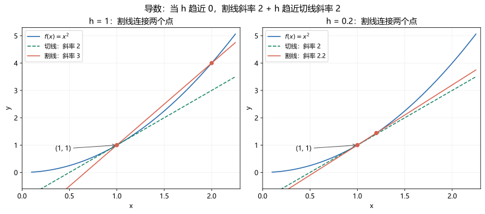

# 02｜导数与微分：把“变化有多快”算出来

[返回数学首页](../README.md) · [高数目录](README.md) · [上一章](01-functions-limits.md) · [下一章](03-derivative-applications.md)

导数不是一开始就背一张公式表。先理解它是在比较“输出变了多少”与“输入变了多少”，再看输入变化越来越小时，这个比值会不会接近一个稳定数。

## 1. 前置知识与目标

需要会：函数代入、展开平方、极限的简单约分、连续的三个条件。本章目标是能从定义求简单导数，熟练处理乘积、商和复合函数，理解切线与微分，能区分连续与可导，并能对一个简单隐函数求导。

第一次可先学到例 3，第二次再学隐函数和微分。每算完一道求导题，回看一次“内层导数有没有漏掉”。

## 2. 新符号与几何直觉

- $h$ 或 $\Delta x$：输入的一个小改变量，可以为正，也可以为负。
- $\Delta y=f(x_0+\Delta x)-f(x_0)$：真实输出改变量。
- $f'(x_0)$：函数在点 $x_0$ 的导数，是一个数。
- $f'(x)$ 或 $dy/dx$：导函数，表示不同位置的变化率。
- $f''(x)$：二阶导数，即对 $f'(x)$ 再求一次导数。
- $dy$：输出变化的线性近似；它与真实改变量 $\Delta y$ 通常不完全相同。

连接曲线上两点得到割线，斜率是 $\Delta y/\Delta x$。让另一点向当前点靠拢，若斜率趋于有限数，这个数就是切线斜率。若位移是时间的函数，平均速度就是割线斜率，瞬时速度就是导数。

图中以 $f(x)=x^2$ 在 $x=1$ 处为例：割线斜率为 $2+h$，当 $h$ 趋近零时趋于切线斜率 $2$。图展示的是变化趋势，导数的值仍由差商极限确定。

## 3. 导数定义：四步模板

在内点 $x_0$，导数定义为

$$
f'(x_0)=\lim_{h\to0}\frac{f(x_0+h)-f(x_0)}h,
$$

前提是这个双侧极限存在且有限。操作时按四步：写函数增量；除以 $h$；在 $h\ne0$ 时整理；最后令 $h\to0$。别在约分前就把 $h$ 代成 $0$。

**例 1：从定义求 $f(x)=x^2$ 在 $x_0=3$ 的导数。**

先算 $f(3+h)-f(3)=(3+h)^2-9=6h+h^2$。再除以 $h$：

$$
\frac{6h+h^2}h=6+h\quad(h\ne0).
$$

取极限得 $f'(3)=6$。曲线经过 $(3,9)$，所以切线方程为

$$
y-9=6(x-3),\qquad y=6x-9.
$$

如果把 $3$ 换成任意 $x$，同样计算得到 $(x^2)'=2x$。这说明求导公式来自定义，并非凭空规定。

## 4. 常用公式：连同条件一起记

在各函数可导且表达式有意义的地方：

$$
 (c)'=0,\quad(x^n)'=nx^{n-1},\quad(e^x)'=e^x,\quad(\ln x)'=\frac1x\ (x>0),
$$

$$
 (\sin x)'=\cos x,\quad(\cos x)'=-\sin x,\quad(\tan x)'=\frac1{\cos^2x}\ (\cos x\ne0).
$$

这里先把幂公式用于整数次幂；对任意实数指数，至少在 $x>0$ 范围内成立。$\sqrt{x}$ 在 $x>0$ 有导数 $1/(2\sqrt{x})$，但不能照公式断言它在 $0$ 有有限导数。

若 $u,v$ 在考察点可导：

$$
 (u+v)'=u'+v',\qquad(cu)'=cu',\qquad(uv)'=u'v+uv',
$$

$$
 \left(\frac uv\right)'=\frac{u'v-uv'}{v^2}\qquad(v\ne0).
$$

乘积公式可以从“添加又减去同一项”看出来：

$$u(x+h)v(x+h)-u(x)v(x)
=[u(x+h)-u(x)]v(x+h)+u(x)[v(x+h)-v(x)].$$

两边除以 $h$ 后取极限，就得到两项。求导不是“每个因子各求一次导后相乘”。

**例 2：求 $y=x^2e^x$ 的导数。**

先认出这是两个函数相乘。令 $u=x^2$、$v=e^x$，则 $u'=2x$、$v'=e^x$。代入公式：

$$
y'=2xe^x+x^2e^x=e^x(x^2+2x).
$$

若误写为 $2xe^x$，就漏掉了“第二个因子本身也随 $x$ 变化”造成的贡献。

## 5. 链式法则：外层导完，还要乘内层导数

若 $u=g(x)$ 在 $x$ 可导，$y=f(u)$ 在相应的 $u$ 可导，则

$$
\frac{dy}{dx}=\frac{dy}{du}\frac{du}{dx}=f'(g(x))g'(x).
$$

读作：“输出对中间量的变化率，乘中间量对输入的变化率。”形式像约分，有助于记忆；严格根据仍是复合函数求导定理，不把每个符号随意拆成普通分数。

**例 3：求 $y=\ln(1+x^2)$ 的导数。**

第一步，$1+x^2>0$，定义域为全体实数。第二步，标出内层 $u=1+x^2$，外层 $y=\ln u$。第三步，分别求导：$du/dx=2x$，$dy/du=1/u$。第四步相乘并换回：

$$
y'=\frac1{1+x^2}\cdot2x=\frac{2x}{1+x^2}.
$$

再如 $y=(2x-1)^5$，外层求导得到 $5(2x-1)^4$，内层导数是 $2$，所以最终为 $10(2x-1)^4$。

## 6. 隐函数求导：把 $y$ 当作 $x$ 的函数

有时关系写成 $F(x,y)=0$，不方便直接整理成 $y=f(x)$。在某点附近确实存在可导的 $y(x)$ 时，可以对等式两边关于 $x$ 求导；凡是含 $y$ 的项，要使用链式法则。

一个常用充分条件是：$F$ 在点附近有连续偏导数，并且该点 $F_y\ne0$，此时可在该点附近解出可导的 $y(x)$，且 $y'=-F_x/F_y$。初学不必先学会一般证明，但要留意求导后是否需要除以一个可能为零的量。

**例 4：求圆 $x^2+y^2=25$ 在 $(3,4)$ 处的切线。**

对两边求导，$x^2$ 得 $2x$；$y^2$ 得 $2yy'$；常数得 $0$：

$$
2x+2yy'=0.
$$

在 $y\ne0$ 的局部支上解得 $y'=-x/y$。代入 $(3,4)$ 得斜率 $-3/4$，因此切线为

$$
y-4=-\frac34(x-3).
$$

不能在 $(5,0)$ 直接把 $y=0$ 代入 $-x/y$；那里圆的切线是竖直线 $x=5$，不具有有限的 $dy/dx$。

## 7. 可导、连续与微分

**可导一定连续，连续不一定可导。** 原因是，当 $h\ne0$ 时

$$
f(x_0+h)-f(x_0)=\frac{f(x_0+h)-f(x_0)}h\cdot h.
$$

若前一因子趋向有限的导数，后一因子趋向 $0$，乘积趋向 $0$，所以函数值趋向 $f(x_0)$。

反例是 $f(x)=|x|$：在 $0$ 连续，但右侧差商 $|h|/h=1$，左侧差商 $|h|/h=-1$，导数不存在。图形的尖角对应两个不同的切线方向。

一元函数在内点可导时，可以写

$$
\Delta y=f'(x_0)\Delta x+o(\Delta x),\qquad dy=f'(x_0)dx,\quad dx=\Delta x.
$$

这里 $o(\Delta x)/\Delta x\to0$，表示误差相比输入改变量更小。$dy$ 是线性主部，$\Delta y$ 是真实变化；二者在导数为零时不能笼统说“相对误差很小”。

**例 5：用微分估计 $\sqrt{9.12}$。**

取 $f(x)=\sqrt{x}$、$x_0=9$、$\Delta x=0.12$。已知 $f(9)=3$、$f'(9)=1/6$，于是

$$
\sqrt{9.12}\approx3+\frac16\times0.12=3.02.
$$

这只是近似：$3.02^2=9.1204$，比目标稍大，所以估计值稍大。误差是否足够小，要结合题目的精度要求，不能把约等号改成等号。

## 8. 典型错法与修正

- $(uv)'=u'v'$：用 $u=v=x$ 检查，错误公式得到 $1$，真实结果为 $2x$。
- 漏乘内层导数：先写出 $u=$ 什么，再套链式法则。
- $(y^2)'=2y$：隐函数题是关于 $x$ 求导，必须写 $2yy'$。
- “连续所以可导”：$|x|$ 在 $0$ 是反例；“不连续所以不可导”则是正确推论。
- 把切线写成 $y=f'(x_0)x$：它还必须经过曲线上的点，应用点斜式。

## 9. 六道独立练习

[完成后看逐步答案](solutions/02-derivatives.md)。所有三角函数使用弧度。

1. **基础**：用定义求 $f(x)=x^2+2x$ 在 $x=1$ 处的导数，并写切线方程。
2. **基础**：求 $y=(3x-2)^4$ 的导数，写出内外层。
3. **巩固**：求 $y=x\ln x$ 的导数并标注定义域。
4. **巩固**：对 $x^2+xy+y^2=7$ 隐式求导，并求 $(1,2)$ 处的斜率。
5. **概念**：判断 $f(x)=|x-1|$ 在 $x=1$ 的连续性和可导性，分别给依据。
6. **应用**：用微分估计 $\sqrt{16.08}$，再通过平方判断估计值偏大还是偏小。

## 10. 过关标准与后续阅读

能独立写出导数定义；能完成前 4 题且没有遗漏链式因子；能解释第 5 题为什么连续但不可导；能明确指出微分估计用了约等号。下一章会用导数判断增减、求最值，而不只是训练计算速度。

本章原创讲解对应武忠祥辅导讲义的一元函数微分学基础部分、竞赛教程上册第 2 章的前置知识；隐函数一般定理可在学习多元微分后重新理解。
