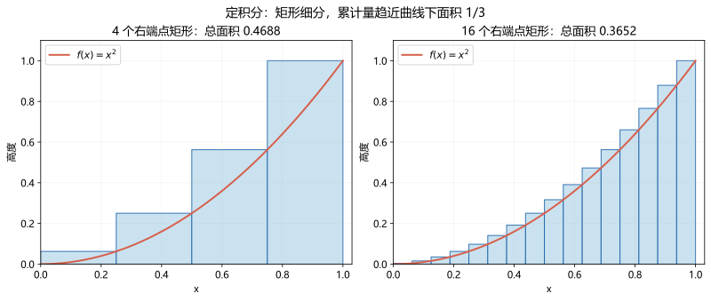

# 05 定积分：把很多小块累加起来

[高数目录](README.md) · [上一章：不定积分](04-indefinite-integrals.md) · [练习解析](solutions/05-definite-integrals.md)

## 1. 前置知识与目标

先会函数、极限、导数和简单原函数。本章要区分“不定积分是一族函数”和“定积分通常是一个数”，会用原函数计算定积分，并知道面积、变上限函数和反常积分的条件。

## 2. 从小矩形想到定积分

假设在区间 $[a,b]$ 上观察函数 $f(x)$。把区间分成很多小段，第 $i$ 段宽 $\Delta x_i$，在其中取一点 $\xi_i$，用小矩形的有向面积 $f(\xi_i)\Delta x_i$ 近似这一小段的累积量。

如果分割越来越细时，这些和趋近同一个数，就把这个极限记成

$$
\int_a^b f(x)\,dx.
$$

其中 $a,b$ 是积分下限和上限，$f$ 是被积函数，$x$ 是积分变量。积分里换用 $t$ 不改变这个数：$\int_a^b f(x)\,dx=\int_a^b f(t)\,dt$。

连续函数在闭区间上一定可积。可积函数不一定连续，但初学阶段先把连续情形掌握好即可。

## 3. 有向面积不等于总面积

当 $f(x)\ge0$ 且 $a<b$，定积分可以解释为图像与横轴之间的面积。图像在横轴下方时，对应贡献是负的。

例如 $f(x)=x$ 在 $[-1,1]$ 上，左右有向面积抵消，所以 $\int_{-1}^1x\,dx=0$。但实际两块三角形的面积之和是 1。

要计算到横轴的总面积，用 $\int_a^b|f(x)|\,dx$。两条曲线围成的面积需要先找交点并确认上下关系，用“上方函数减下方函数”积分，不能只按题目出现顺序相减。

## 4. 微积分基本定理：累积和变化率接上了

若 $f$ 在 $[a,b]$ 上连续，定义

$$
F(x)=\int_a^x f(t)\,dt,
$$

则在区间内部 $F'(x)=f(x)$。直觉上：上限增加一点时，累积量新增一个“宽度很小、高度约为 $f(x)$”的小块。

若 $\Phi'(x)=f(x)$，于是可以用牛顿—莱布尼茨公式：

$$
\int_a^b f(x)\,dx=\Phi(b)-\Phi(a).
$$

积分常数不需要写到最终的定积分结果里，因为 $(\Phi(b)+C)-(\Phi(a)+C)$ 中的 $C$ 会抵消。这个公式不允许你跨过被积函数的奇点假装它仍是普通连续函数。

## 5. 例题一：按定义角色完成一次计算

求 $\int_0^2(2x+1)\,dx$。

1. 被积函数在 $[0,2]$ 连续，适用基本定理。
2. 一个原函数为 $\Phi(x)=x^2+x$。
3. 代入上限得 $\Phi(2)=6$，代入下限得 $\Phi(0)=0$。
4. 作差得到 $6$。
5. 粗略核对：区间宽为 2，函数值从 1 到 5，平均高度为 3，所以面积应为 6。

“先代上限再减下限”是计算次序；反过来写会改变符号。

## 6. 例题二：先看谁在上面，再求面积

求 $y=x$ 和 $y=x^2$ 围成区域的面积。

先求交点：$x=x^2$，得到 $x=0,1$。在 $0<x<1$，有 $x>x^2$，直线在上，抛物线在下。于是

$$
S=\int_0^1(x-x^2)\,dx
=\left[\frac{x^2}{2}-\frac{x^3}{3}\right]_0^1
=\frac16.
$$

括号 $[\Phi(x)]_a^b$ 只是 $\Phi(b)-\Phi(a)$ 的简写。面积应非负；如果算出负数，应优先检查上下函数和积分方向。

## 7. 定积分换元：变量和上下限一起换

计算 $\int_0^1 2x e^{x^2}\,dx$。令 $u=x^2$，则 $du=2x\,dx$。当 $x=0$，$u=0$；当 $x=1$，$u=1$。因此

$$
\int_0^1 2x e^{x^2}\,dx=\int_0^1 e^u\,du=e-1.
$$

恰好上下限数值没变只是这个例子的巧合。若原上限为 2，新上限应为 4。改用了 $u$ 后仍代入旧的 $x$ 上下限，是常见错误。

也可以先求关于 $x$ 的原函数 $e^{x^2}$，再代入原来的 $x$ 上下限。这两种路线都合法，但不要混在一步里。

## 8. 变上限函数：导数后还要用链式法则

例题三：求 $G(x)=\int_0^{x^2}\sqrt{1+t^2}\,dt$ 的导数。

先把累积函数写作 $H(u)=\int_0^u\sqrt{1+t^2}\,dt$，连续性保证 $H'(u)=\sqrt{1+u^2}$。又因为 $G(x)=H(x^2)$，所以

$$
G'(x)=H'(x^2)\cdot2x=2x\sqrt{1+x^4}.
$$

若上下限都变，且被积函数连续、上下限可导，则

$$
\frac d{dx}\int_{\alpha(x)}^{\beta(x)}f(t)\,dt
=f(\beta(x))\beta'(x)-f(\alpha(x))\alpha'(x).
$$

先确认被积函数是否还显式包含外部变量 $x$；本公式是仅通过上下限依赖 $x$ 的情形，不能直接套到任意含参积分上。

## 9. 反常积分：先变成极限，再问是否收敛

区间无界，或者被积函数在端点/内部无界时，需要用极限定义。例题四：

$$
\int_1^{+\infty}\frac1{x^p}\,dx
=\lim_{R\to+\infty}\int_1^R x^{-p}\,dx.
$$

当 $p\ne1$，有限区间的积分为 $\frac{R^{1-p}-1}{1-p}$。当 $p>1$ 时，$R^{1-p}\to0$，结果为 $\frac1{p-1}$；当 $p<1$ 时发散。$p=1$ 时，结果为 $\lim\ln R=+\infty$，也发散。

因此这一积分恰好在 $p>1$ 时收敛。但 $\int_0^1x^{-p}\,dx$ 看的是零点附近，恰好在 $p<1$ 时收敛，两个端点问题不能记反。

如果内部有奇点，必须分开检查两侧。例如 $\int_{-1}^1 1/x\,dx$ 的两侧积分都不收敛，不能用“奇函数对称抵消”说普通反常积分等于零。对称取极限得到的主值是另一种概念。

## 10. 六道独立练习

1. 求 $\int_0^2(3x^2+1)\,dx$。
2. 换元计算 $\int_0^1x e^{x^2}\,dx$。
3. 求 $y=2x$ 与 $y=x^2$ 围成区域的面积。
4. 求 $F(x)=\int_1^{\sin x}e^{t^2}\,dt$ 的导数。
5. 判断 $\int_1^{+\infty}x^{-3}\,dx$ 是否收敛；收敛则求值。
6. 判断 $\int_{-1}^1x^{-2}\,dx$ 是否收敛。为什么不能直接把原函数 $-1/x$ 代入两个端点作差？

[逐步解析](solutions/05-definite-integrals.md)

## 11. 过关标准

能说明定积分的累积含义；会检查连续性与奇点；能用原函数计算并核对符号；换元会改变上下限；变上限求导不漏链式法则；反常积分先谈收敛，再谈数值。
