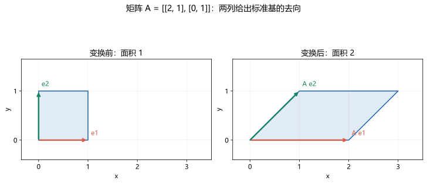

# 02 矩阵：给向量一套变换规则

[上一章：向量](01-vectors.md) · [返回目录](README.md) · [下一章：行列式](03-determinants.md) · [练习详解](solutions/02-matrices.md)

## 1. 前置知识、目标与符号

先会向量加法与数乘，知道线性组合的含义。本章要学会判断矩阵能否相乘、按行乘列计算乘积、解释每一列的几何意义、计算二阶逆矩阵，并在使用逆之前检查条件。

矩阵是按行列排列的数表，本身不是一个数。$m\times n$ 表示 $m$ 行 $n$ 列：先横行，后竖列。$m=n$ 时才叫方阵。矩阵里的数字叫元素，$a_{ij}$ 中第一个下标是行号，第二个是列号。

| 符号 | 意义 |
|---|---|
| $A\in\mathbb R^{m\times n}$ | $A$ 是实数构成的 $m$ 行 $n$ 列矩阵 |
| $A^T$ | 转置，把行与列交换，尺寸变成 $n\times m$ |
| $I_n$ | 主对角线上为 1，其余为 0 的 $n$ 阶单位矩阵 |
| $A^{-1}$ | 把 $A$ 的作用还原的逆矩阵，仅对可逆方阵使用 |
| $T(x)=Ax$ | 用矩阵 $A$ 定义的向量变换 |

## 2. 矩阵乘向量为什么这样算

设

$$
A=\begin{pmatrix}2&1\\0&3\end{pmatrix},\qquad
x=\begin{pmatrix}x_1\\x_2\end{pmatrix}.
$$

按行和列对应相乘再相加：

$$Ax=\begin{pmatrix}2x_1+x_2\\3x_2\end{pmatrix}
=x_1\begin{pmatrix}2\\0\end{pmatrix}
+x_2\begin{pmatrix}1\\3\end{pmatrix}.$$

第二种写法说明：矩阵乘向量，其实是用向量分量作为系数，对矩阵的各列做线性组合。尤其 $Ae_1$ 是第一列，$Ae_2$ 是第二列。因此，只要知道标准基的去向，就知道整个平面的去向。

矩阵变换满足

$$
A(u+v)=Au+Av,\qquad A(cu)=cAu.
$$

这两个条件分别叫可加性与齐次性，合起来叫**线性**。它保证先组合再变换，与先变换再组合一致。任何线性变换都把零向量变为零向量。

注意“图像是一条直线”不是线性变换的完整定义。例如 $T(x)=2x+1$ 是中学的一次函数，但 $T(0)=1\ne0$，在线性代数的严格定义下不线性；它属于仿射变换。反过来，$T(0)=0$ 也不充分，例如 $T(x)=x^2$ 仍不满足可加性。

非方阵同样能表示线性变换。一个 $2\times3$ 矩阵把三维向量变成二维向量；输入和输出的维数可以不同，不必强行画在同一平面中。

## 3. 矩阵运算及其条件

相同尺寸的矩阵才能相加，按对应元素相加。数乘矩阵要乘每一个元素。

若 $A$ 为 $m\times n$、$B$ 为 $n\times p$，乘积 $AB$ 才有定义，结果是 $m\times p$。内侧尺寸 $n$ 匹配，外侧尺寸留下。第 $i$ 行第 $j$ 列的元素是

$$
(AB)_{ij}=\sum_{k=1}^n a_{ik}b_{kj}.
$$

$\sum$ 是求和符号，表示把 $k=1$ 到 $n$ 的这些乘积加起来。$AB$ 的第 $j$ 列等于 $A$ 乘 $B$ 的第 $j$ 列。

乘积 $AB$ 表示**先做 $B$，再做 $A$**：$(AB)x=A(Bx)$。顺序来自嵌套计算，最靠近 $x$ 的先执行。两个变换先后顺序通常会影响结果，因此一般 $AB\ne BA$；有时 $AB$ 有定义而 $BA$ 根本没定义。

乘法满足结合律 $(AB)C=A(BC)$ 和分配律，但不能随意交换因子。转置则会反转乘积次序：$(AB)^T=B^TA^T$。

## 4. 逆矩阵：什么时候能把过程倒回来

对 $n$ 阶方阵 $A$，若存在 $B$ 使 $AB=BA=I_n$，则 $A$ 可逆，记 $B=A^{-1}$。逆矩阵唯一。

几何上，可逆表示不同输入不会被压到相同输出，且每个目标都能达到。如果把平面投影到一条直线上，就丢失了一个方向的信息，无法从输出唯一还原输入，这种方阵不可逆。

二阶公式为

$$
A=\begin{pmatrix}a&b\\c&d\end{pmatrix},\quad
ad-bc\ne0
\quad\Longrightarrow\quad
A^{-1}=\frac1{ad-bc}\begin{pmatrix}d&-b\\-c&a\end{pmatrix}.
$$

条件 $ad-bc\ne0$ 不能漏。为什么这个公式成立？直接相乘：

$$
\begin{pmatrix}a&b\\c&d\end{pmatrix}
\begin{pmatrix}d&-b\\-c&a\end{pmatrix}
=\begin{pmatrix}ad-bc&0\\0&ad-bc\end{pmatrix}.
$$

再除以 $ad-bc$ 就是单位矩阵。如果分母是零，这一步没有意义。

逆不是把每个元素取倒数。零元素可能出现在可逆矩阵中，例如 $I_2$。对可逆矩阵，有 $(AB)^{-1}=B^{-1}A^{-1}$：撤销动作时必须倒序。非方阵本章不定义这种双侧逆；即便能找到只满足一侧等式的矩阵，也不能当作普通逆使用。

## 5. 三个完整例题

### 例 1：从矩阵读出变换

设 $A=\begin{pmatrix}2&1\\0&1\end{pmatrix}$，求 $A(3,-1)^T$，并解释两列。

第一行算 $2\times3+1\times(-1)=5$，第二行算 $0\times3+1\times(-1)=-1$，所以结果为 $(5,-1)^T$。

矩阵第一列表示 $e_1$ 变为 $(2,0)^T$，第二列表示 $e_2$ 变为 $(1,1)^T$。原向量是 $3e_1-e_2$，变换后为 $3(2,0)^T-(1,1)^T=(5,-1)^T$。两种算法互相检验。

### 例 2：交换顺序会改变结果

令 $A=\begin{pmatrix}1&1\\0&1\end{pmatrix},B=\begin{pmatrix}2&0\\0&1\end{pmatrix}$。

计算 $AB$：第一行乘两列分别得 $1\times2+1\times0=2$、$1\times0+1\times1=1$；第二行得到 0、1。因此 $AB=\begin{pmatrix}2&1\\0&1\end{pmatrix}$。

计算 $BA$：第一行得 2、2，第二行得 0、1，所以 $BA=\begin{pmatrix}2&2\\0&1\end{pmatrix}$，两者不相等。

用 $x=(0,1)^T$ 检查：先 $B$ 后 $A$，输出 $(1,1)^T$；先 $A$ 后 $B$，输出 $(2,1)^T$。区别不是计算偶然出错，而是变换顺序本来不同。

### 例 3：求逆并用它解方程

令 $A=\begin{pmatrix}2&1\\1&1\end{pmatrix}$，解 $Ax=(5,3)^T$。

先算 $ad-bc=2\times1-1\times1=1\ne0$，所以可逆，

$$
A^{-1}=\begin{pmatrix}1&-1\\-1&2\end{pmatrix}.
$$

等式两边左乘 $A^{-1}$，得到 $x=A^{-1}(5,3)^T=(5-3,-5+6)^T=(2,1)^T$。

检查 $Ax=(2\times2+1,2+1)^T=(5,3)^T$。若误把右侧写成行向量再右乘，就会改变问题的形式；这里未知量一直是列向量。

图对应例 1 的矩阵：两列给出两根标准基的去向，单位正方形变为平行四边形。面积变为 2 倍，后面会用行列式精确表达这个倍数。

## 6. 反例与判断清单

$A=\begin{pmatrix}1&2\\2&4\end{pmatrix}$ 非零，却不可逆，因为第二行是第一行的两倍，也因为 $A(-2,1)^T=0$。非零输入与零输入都映射到零，信息已经丢失。

矩阵还可能出现 $AB=0$ 而 $A,B$ 都非零。例如 $A=\operatorname{diag}(1,0),B=\operatorname{diag}(0,1)$。因此不能照搬实数的“乘积为零必有一个为零”，也不能在 $AX=AY$ 两边随便约去 $A$。只有证明 $A$ 可逆后，才可左乘 $A^{-1}$ 约去。

动笔检查三件事：尺寸匹配吗？次序对吗？求逆条件满足吗？很多“难题”其实是在这三处设置陷阱。

## 7. 分层练习

### 练习 1｜入门：尺寸

$A$ 是 $2\times3$，$B$ 是 $3\times4$。判断 $AB,BA,A^TB$ 是否有定义，并写出有定义者的尺寸。

### 练习 2｜入门：乘向量

计算 $\begin{pmatrix}1&2&-1\\0&3&2\end{pmatrix}(2,-1,4)^T$，并把结果写为矩阵各列的线性组合。

### 练习 3｜常规：两个乘积

取 $A=\begin{pmatrix}1&2\\0&1\end{pmatrix},B=\begin{pmatrix}1&0\\3&1\end{pmatrix}$，求 $AB,BA$，判断是否相等。

### 练习 4｜常规：逆与方程

求 $A=\begin{pmatrix}3&1\\2&1\end{pmatrix}$ 的逆矩阵，并解 $Ax=(7,5)^T$。

### 练习 5｜提高：参数与可逆性

矩阵 $A_t=\begin{pmatrix}1&t\\t&1\end{pmatrix}$ 何时可逆？写出可逆时的逆矩阵，并分别说明 $t=1,-1$ 时丢失的一个非零方向。

### 练习 6｜概念：线性与非线性

判断 $T_1(x,y)=(x+y,2y)$、$T_2(x,y)=(x+1,y)$、$T_3(x,y)=(x^2,y)$ 是否线性。线性的写出矩阵；不线性的给出具体反例。

[完成后看详解](solutions/02-matrices.md)。

## 8. 过关标准

能先写尺寸再算乘积；不用背口号也能用一个向量解释“右边先做”；会算二阶逆并乘回单位矩阵；前 4 题都能独立完成，且不会对不可逆矩阵随意约分。
